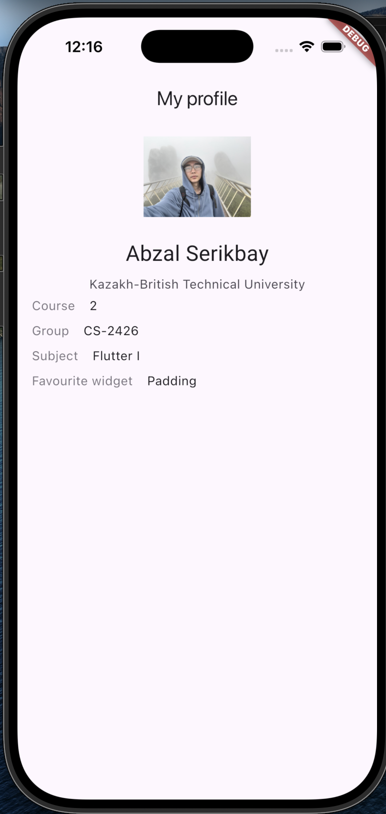
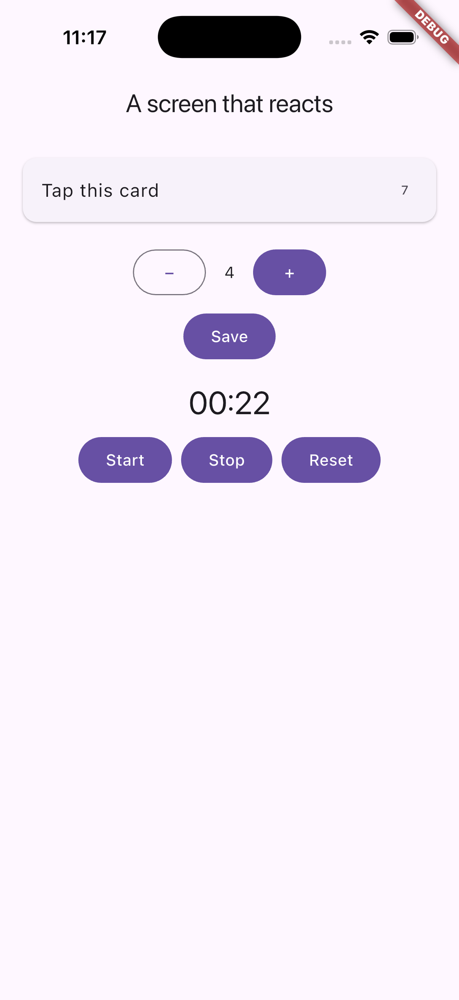
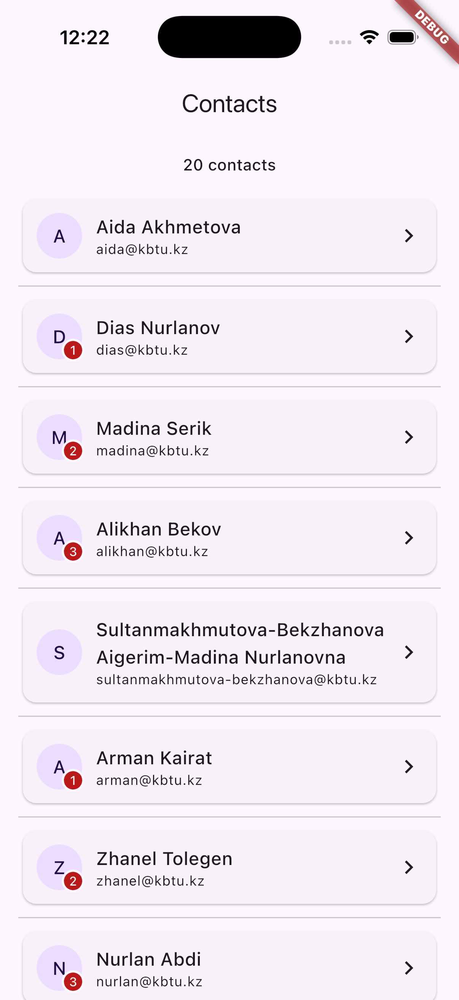
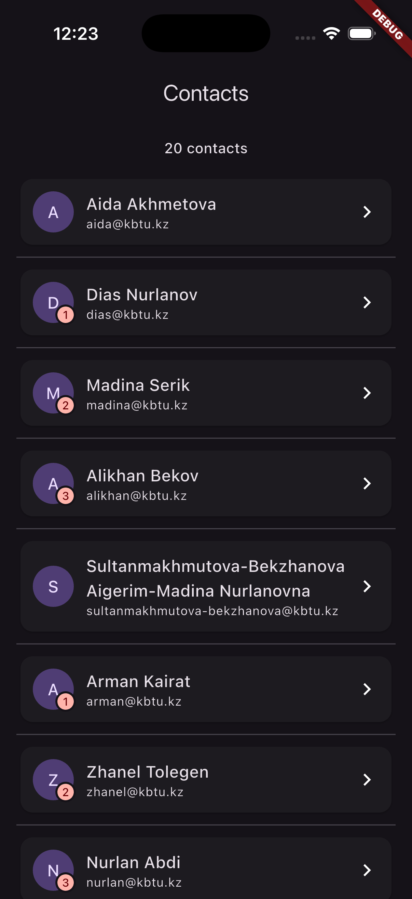
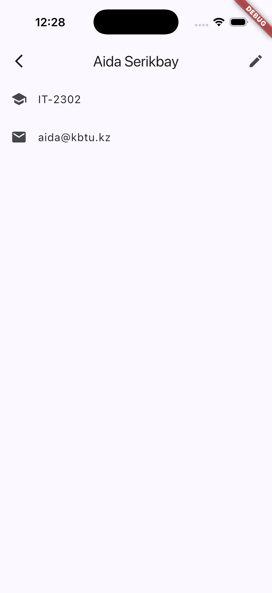
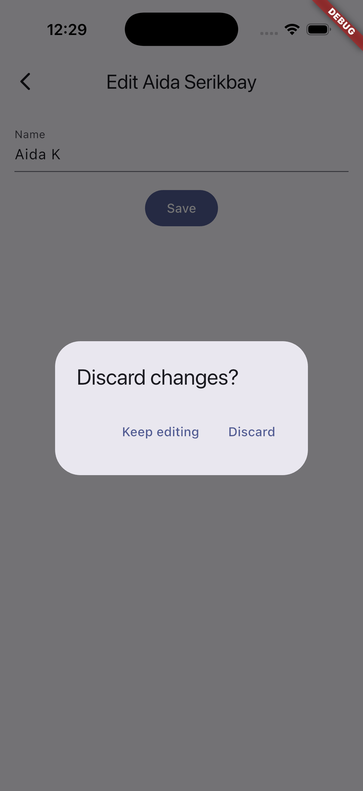

# Mobile Application Development with Flutter I


Weekly practice work for the university course "Mobile Application Development with Flutter I" (2026). Each week is a separate folder under `lib/`; weeks 3-6 are standalone Flutter projects.

## Weeks

| Week | Topic | What is built |
|------|-------|---------------|
| 02 | Dart language | Console program: abstract class, mixin, `sealed` class, enums, JSON parsing and null safety on a small library catalogue |
| 03 | Layout basics | Profile screen (header, info rows, asset image) |
| 04 | Stateful widgets | Tap card, two-way counter and stopwatch with `setState` |
| 05 | Responsive layout | Contact list that never overflows, in light and dark themes |
| 06 | Navigation | Students list, detail and edit screens with named routes, `onGenerateRoute`, route arguments, a result passed back and a confirm dialog |

## Screenshots

<p>
  
  
  
  
</p>
<p>
  
  
</p>

## Structure

```
lib/
├── week02/   # Dart-only: models, catalogue, shelf_state, main
├── week03/   # Flutter project: profile screen
├── week04/   # Flutter project: stateful widgets
├── week05/   # Flutter project: responsive contacts
└── week06/   # Flutter project: navigation (students)
```

## Getting started

```bash
# Week 2 (plain Dart)
dart run lib/week02/main.dart

# Weeks 3-6
cd lib/week06
flutter pub get
flutter run
```
