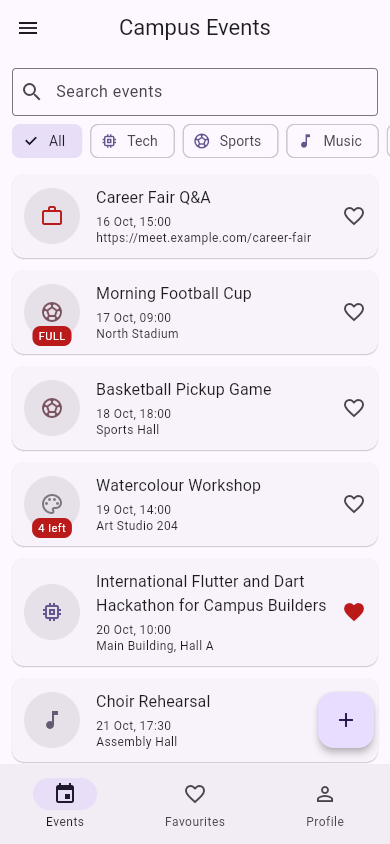
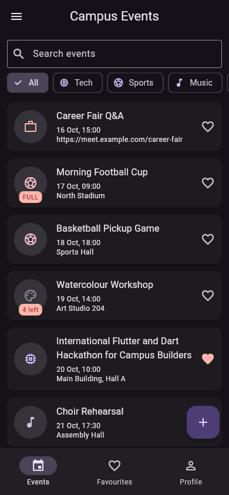
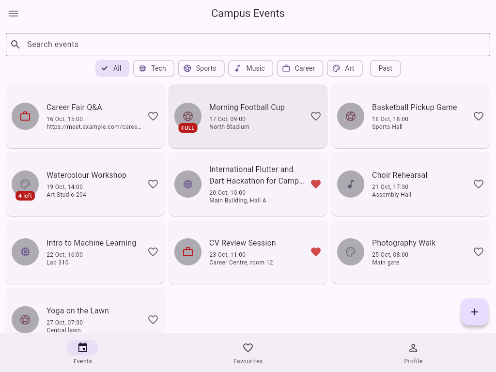

# Campus Events

Campus events with a category, a start time and a capacity. You can search and filter events, save favourites, register for an event, and create or edit events. All data lives in memory.

| Phone, light | Phone, dark | Tablet grid |
| --- | --- | --- |
|  |  |  |

## Decisions

The list of events and the profile live in the State of `Shell`. The tabs get them as constructor parameters and send changes back up through callbacks, so there is only one source of truth. The detail screen gets the event and callbacks because it changes an event that lives somewhere else and has to report each change while it stays open. The form only creates a value, so it returns the new event through `pop` and the caller decides what to do with it. The grid is chosen by `LayoutBuilder` because it depends on the width given to the list, not on the screen size, so it would still work inside a split view. `PopScope` compares a record of the current field values with the record taken when the form opened, so the form is dirty only when something really changed. With week 9's tools I would move the state out of `Shell` into a shared state object and keep the data in local storage.
