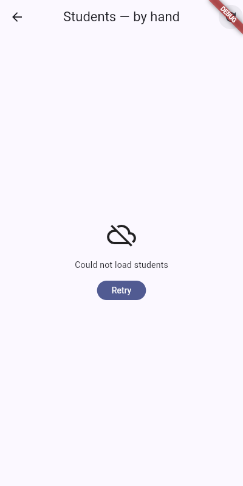
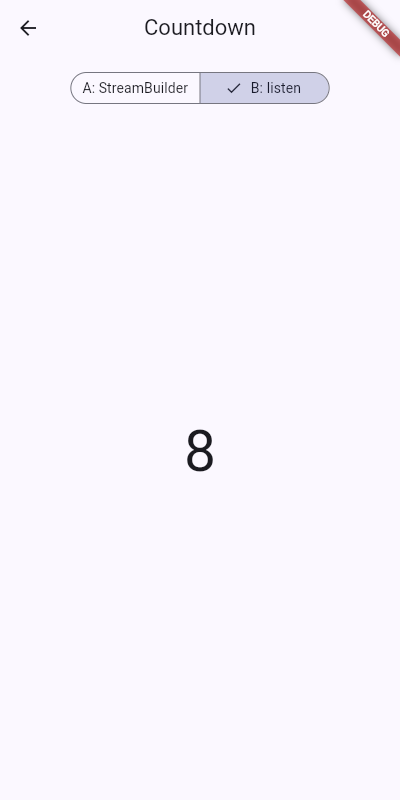

# Practice 10 — The Data Arrives Later

Students screen over a fake API that takes 2 s and fails every third call.

- **By hand** — `lib/students_screen.dart`: three fields, four states, Retry, Save with snackbar on error
- **FutureBuilder** — `lib/students_future_screen.dart`: Future in a field, compact Switch that does not reload
- **Countdown** — `lib/countdown_screen.dart`: version A (StreamBuilder) and B (listen + cancel)

Notes: [NOTES.md](NOTES.md)

| Error view | Countdown B |
|---|---|
|  |  |
