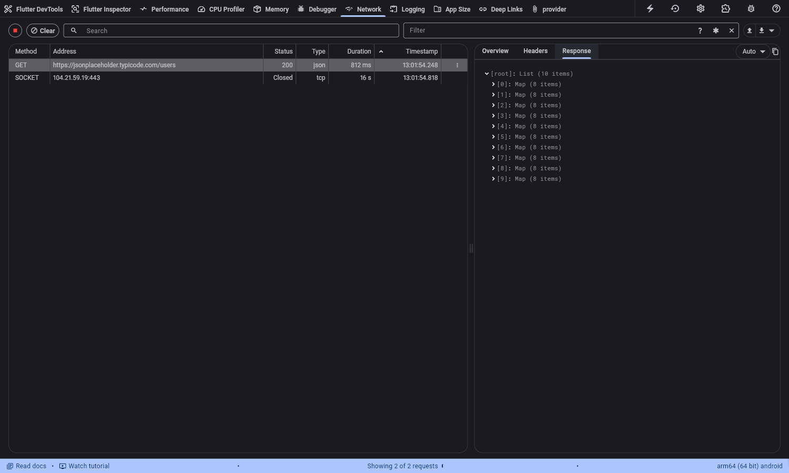
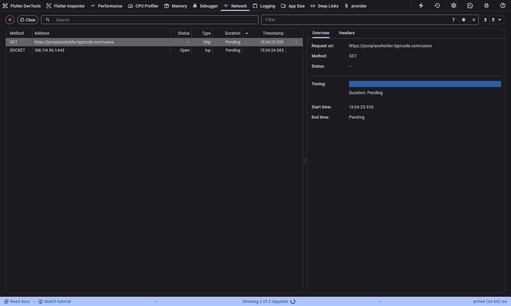

# Practice 11 — A Real Server

Users from `jsonplaceholder.typicode.com` instead of the fake API.

- **Model** — `lib/features/users/user.dart`: `User`, `Address`, `Geo` with `fromJson` / `toJson`
- **Api** — `lib/core/api/api_client.dart`: the only class that calls `http`; 10 s timeout, status → `ApiException`
- **Repository** — `lib/features/users/user_repository.dart`: `getAll`, `getById`, `create`
- **Chain** — `UsersModel` (`ChangeNotifier`) → `UsersScreen` with an exhaustive `switch` on the sealed error
- **Form** — `lib/features/users/new_user_screen.dart`: POST, Save disabled while in flight

Notes: [NOTES.md](NOTES.md)

| 200 with the body | Timeout, no status |
|---|---|
|  |  |
